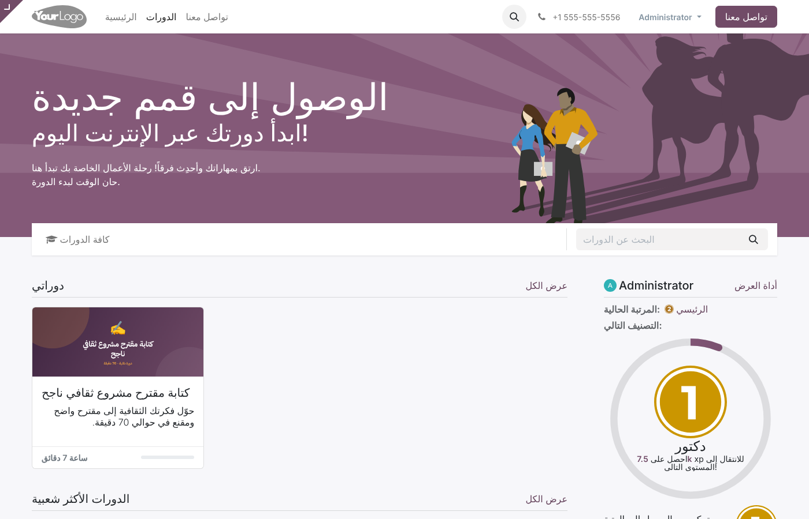
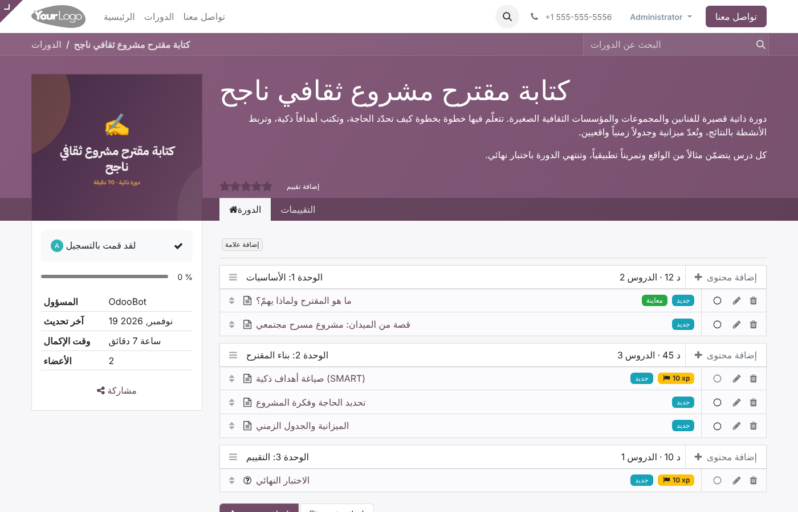
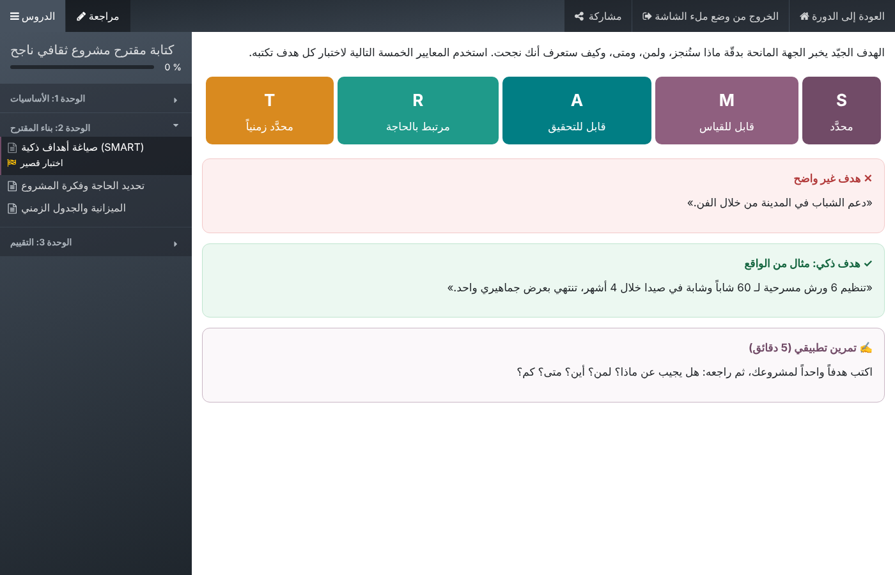
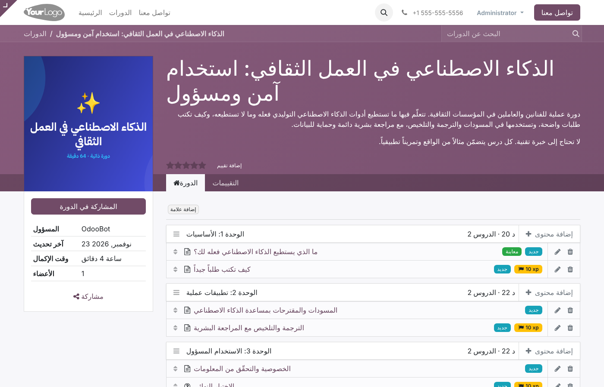
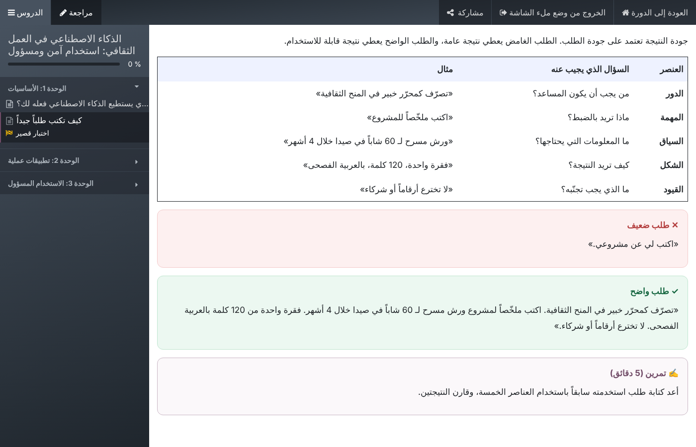

# Odoo eLearning Lab

A hands-on learning project: run **Odoo 17 eLearning** in Docker and ship **Arabic, right-to-left courses as installable Odoo modules**, with tests, CI, backups and a production setup.

> Learning project by NovaTechAI. The three courses are original Arabic content; the cases, organisations and figures are fictional and built for practice.

**Live site:** https://learn.novatechai.site/slides



## The courses

| Course | Module | Focus |
|---|---|---|
| تصميم مقترح ثقافي قابل للتمويل والتقييم | `nova_course_proposal_writing` | Funding calls, theory of change, indicators, budget and cash flow |
| التحرير الثقافي بالذكاء الاصطناعي تحت إشراف بشري | `nova_course_ai_cultural_work` | AI-assisted editing, fact checking, translation review, publishing decisions |
| إدارة المخاطر الرقمية واستمرارية العمل الثقافي | `nova_course_digital_safety` | Business impact, access reviews, incident response, restore drills |

The optional **Nova Learning Studio** module (`nova_learning_studio`) adds course landing pages (skills, audience, deliverables, FAQ, verified references), illustrated lesson guides, short films with transcripts, and styled lesson sections with hidden model answers. See [docs/07-learning-studio.md](docs/07-learning-studio.md).

## The 4 projects

| # | Project | What you learn | Guide |
|---|---------|----------------|-------|
| 1 | **Odoo in Docker** | Dockerfile, docker-compose, Postgres, config, volumes, Makefile | [docs/01-odoo-docker.md](docs/01-odoo-docker.md) |
| 2 | **Course module: Writing a Cultural Project Proposal** (`كتابة مقترح مشروع ثقافي ناجح`) | Odoo module structure, XML data, courses, lessons, quizzes, RTL HTML | [docs/02-course-module.md](docs/02-course-module.md) |
| 3 | **Course module: Digital Safety for Cultural Organisations** (`الأمان الرقمي للمؤسسات الثقافية`) | Reusing the pattern, writing Odoo unit tests | [docs/03-second-course-and-tests.md](docs/03-second-course-and-tests.md) |
| 4 | **Ops toolkit** | Backups and restore, Nginx + HTTPS, production workers, GitHub Actions CI | [docs/04-ops-toolkit.md](docs/04-ops-toolkit.md) |
| + | **Publish live** | Put the courses on a public link (server + HTTPS, or Odoo Online) | [docs/05-publish-live.md](docs/05-publish-live.md) |
| + | **Cloudflare Tunnel** | Free public HTTPS link from your own computer, no server | [docs/06-cloudflare-tunnel.md](docs/06-cloudflare-tunnel.md) |
| + | **Course module: AI in Cultural Work** (`الذكاء الاصطناعي في العمل الثقافي`) | A third course built with the same pattern: prompting, drafting, translation, privacy | `addons/nova_course_ai_cultural_work/` |

## Quick start

Requirements: Docker with Compose v2.24+, `make`.

```bash
git clone <this-repo> odoo-elearning-lab && cd odoo-elearning-lab
cp .env.example .env          # then edit the passwords
make up                       # build the image, start Odoo + Postgres
make init                     # create the database in Arabic and install the three courses
```

Open http://localhost:8069, log in with `admin` / `admin`, change the password, then go to **Website → Courses**.

| Command | What it does |
|---------|--------------|
| `make logs` | Follow Odoo logs |
| `make update` | Reload course data after editing XML |
| `make test` | Run the module tests in a throwaway database |
| `make backup` / `make restore FILE=...` | Back up or restore database + filestore |
| `make prod-up` | Production stack behind Nginx |
| `make quick-tunnel` / `make tunnel` | Public link via Cloudflare (test link / your domain) |
| `make clean` | Stop and **delete** all data |

## Repository layout

```
.
├── Dockerfile                  # Odoo 17 image with our addons baked in
├── docker-compose.yml          # Odoo + Postgres for local development
├── config/odoo.conf            # Odoo server configuration
├── Makefile                    # Shortcuts (make help)
├── addons/
│   ├── nova_course_proposal_writing/   # Course 1 as an Odoo module
│   ├── nova_course_digital_safety/     # Course 2 as an Odoo module
│   ├── nova_course_ai_cultural_work/   # Course 3 as an Odoo module
│   └── nova_learning_studio/           # Landing pages, artwork, films, lesson styling
├── curriculum/                 # Arabic course scripts and editorial review
├── tools/                      # Course media builder (diagrams, stills, films)
├── ops/
│   ├── scripts/                # backup.sh, restore.sh, healthcheck.sh
│   ├── nginx/odoo.conf         # reverse proxy with HTTPS and websockets
│   └── docker-compose.prod.yml # production overrides
├── .github/workflows/ci.yml    # lint, install + test on Odoo 17, docker build
└── docs/                       # step-by-step learning guides
```

## Screenshots (real Odoo 17)

| Course page | Lesson |
|---|---|
|  |  |
|  |  |

All three course modules were installed on a clean Odoo 17 database with Arabic loaded, and all 15 unit tests pass.

---

## بالعربية

مشروع تعليمي عملي لتشغيل **Odoo 17 eLearning** باستخدام Docker، وبناء **دورات عربية من اليمين إلى اليسار على شكل وحدات (modules) قابلة للتثبيت**، مع اختبارات وتكامل مستمر ونسخ احتياطي وإعداد للإنتاج.

**المشاريع الأربعة:**

1. **Odoo داخل Docker:** ملف Dockerfile وdocker-compose وقاعدة بيانات Postgres والإعدادات.
2. **وحدة دورة «كتابة مقترح مشروع ثقافي ناجح»:** بنية وحدة Odoo، وملفات XML للبيانات، والدروس والاختبارات.
3. **وحدة دورة «الأمان الرقمي للمؤسسات الثقافية»:** إعادة استخدام النمط نفسه وكتابة اختبارات الوحدات.
4. **أدوات التشغيل:** النسخ الاحتياطي والاستعادة، وNginx مع HTTPS، وGitHub Actions.

**البدء السريع:**

```bash
cp .env.example .env
make up
make init
```

ثم افتح http://localhost:8069 وادخل بالمستخدم `admin` وكلمة المرور `admin`، وغيّرها فوراً.

The [Learning Studio guide](docs/07-learning-studio.md) covers installation, course artwork, illustrated lessons and film generation.

## License

MIT. See [LICENSE](LICENSE).
